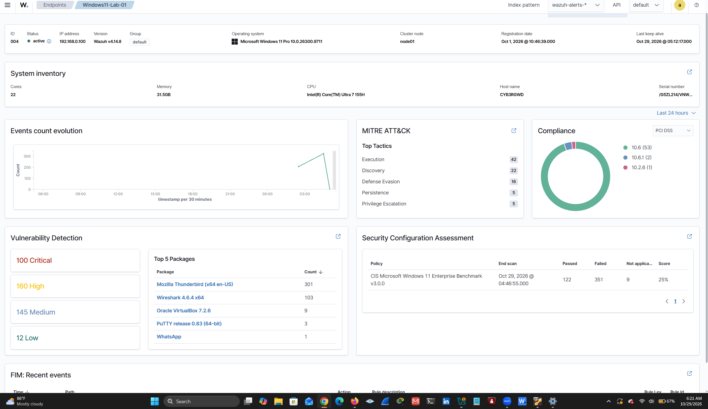
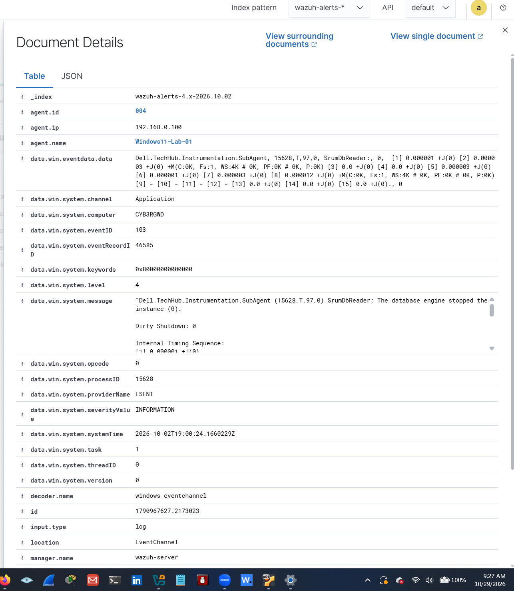
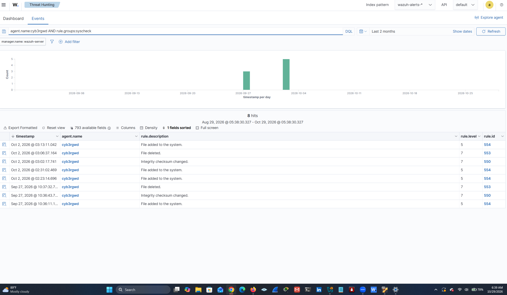
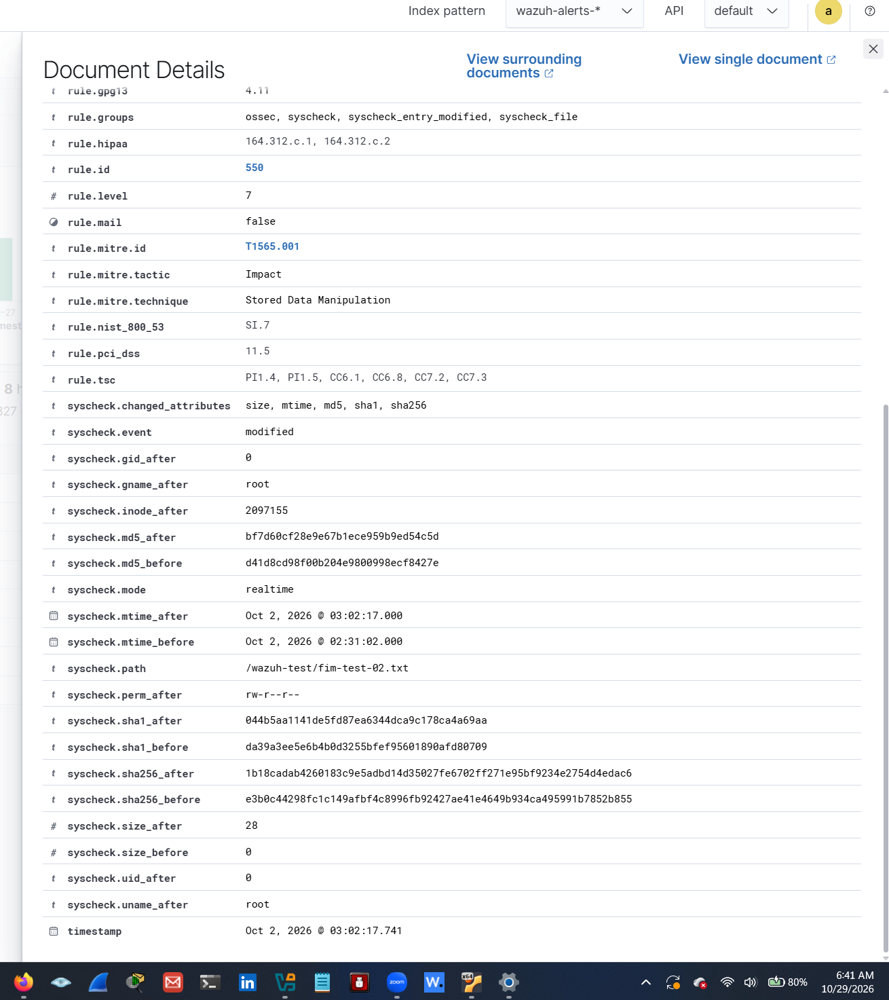
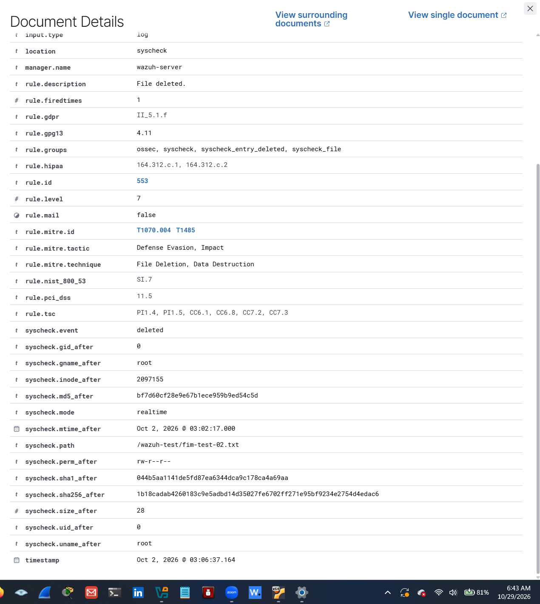

# Wazuh Windows and Kali Linux SIEM Lab

A hands-on Security Information and Event Management (SIEM) project using Wazuh to monitor Windows 11 security events and Kali Linux file integrity events.

## Project Overview

This project demonstrates endpoint monitoring, log collection, security event investigation, and File Integrity Monitoring (FIM) in a virtual lab environment.

## Lab Environment

- **SIEM:** Wazuh
- **Windows endpoint:** Windows 11 Pro
- **Windows telemetry:** Windows Event Logs and Sysmon
- **Linux endpoint:** Kali Linux
- **Linux monitoring:** Wazuh File Integrity Monitoring
- **Virtualization:** VirtualBox

## Windows Security Monitoring

The Windows agent `Windows11-Lab-01` was monitored through Wazuh. The investigation included reviewing Windows event records and process-related detections.

### Windows Monitoring Evidence

**Wazuh Agents**

**Windows Sysmon Log**

**Windows Sysmon Log Capture**

**Windows Lab Endpoint**

## Kali Linux File Integrity Monitoring

The Kali agent `cyb3rgwd` monitored file-integrity activity involving:

`/wazuh-test/fim-test-02.txt`

Wazuh recorded file additions, checksum changes, and deletions. The modification event included changes to file metadata and cryptographic hashes.

### FIM Overview

### File Modification Evidence

### File Deletion Evidence

## Project Documentation

- [Original Project Report](docs/original-project-report.pdf)
- [Expanded Project Analysis](docs/expanded-project-analysis.pdf)

 ## Project Results

| Test | Result |
|---|---|
| Windows 11 monitoring | Windows Event Logs and Sysmon reviewed in Wazuh |
| Kali Linux file monitoring | File creation, modification, and deletion detected |
| File integrity analysis | File metadata and hashes recorded |
| Security investigation | Wazuh alerts reviewed and documented |

**Project status:** Windows and Kali Linux monitoring validated. Metasploitable 3 integration is planned.

## Skills Demonstrated

- Wazuh SIEM monitoring
- Windows event-log investigation
- Sysmon telemetry review
- Linux file-integrity monitoring
- Security-event triage and documentation
- Virtual lab configuration and troubleshooting

## Future Work

- Complete Metasploitable 3 integration with Wazuh.
- Extend security-event detection and analysis.
- Document additional lab scenarios and results.

## Ethical Use

This project was conducted in a controlled virtual lab for educational and defensive cybersecurity purposes.
